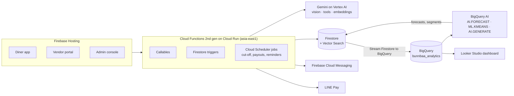

# BunnBaa 飯飽 — AI Pre-order Platform for Small Eateries

**Lock your meal early. Small eateries know exactly what to cook — and nothing goes to waste.**

Google AI Builder Cup 2026 · Theme: **Retail & Commerce — Intelligent Customer and Business Experiences** · Domain: Sustainability (food waste)

| | |
|---|---|
| Live prototype | https://bunnbaa-mvp-5474.web.app (Firebase Hosting + Cloud Run, project `bunnbaa-mvp-5474`) |
| Demo video (3 min) | [YouTube / Vimeo / Drive link] |
| Proposal deck (PDF) | [link] |
| Try it | Diner: [demo account] · Vendor portal: [demo account] |

---

## The problem

Small eateries near campuses and offices buy ingredients before anyone orders. Guess high and food is thrown away; guess low and customers are turned away. Diners queue every day with no guarantee and no reason to decide early. Even a prepaid meal is wasted when its owner's plans change, because nobody else knows it is available.

## The solution

BunnBaa turns walk-in guesswork into confirmed, prepaid demand:

1. **Lock** — diners book breakfast, lunch or dinner up to 30 days ahead. The earlier they book, the bigger the discount (20% off two or more days ahead, 5% for tomorrow). Paid with LINE Pay.
2. **Cut-off** — at 20:00 the day before, the vendor gets an exact count plus auto-generated purchase and prep lists.
3. **Pass it on** — a diner who can't come can resell the meal at their own price, gift it, or donate it as a free charity meal. Unclaimed meals become charity meals automatically.
4. **Pick up** — a signed QR code is scanned at the counter.

Vendors pay no monthly fee; the platform takes 5% of each meal sold.

## How Google AI is used

Gemini (served through **Vertex AI**) runs through the whole life of a meal, and **BigQuery AI** turns the order history into forecasts and customer insight.

| Stage | Feature | Google AI | Code |
|---|---|---|---|
| List | A photo of a paper menu becomes structured, bilingual menu drafts (price, category, dietary tags, allergens) that the owner confirms | Gemini multimodal, JSON output | `functions/src/menuVision.js` |
| Find | Conversational pre-order assistant: *"Lunch next Mon–Fri, Da'an, under NT$120, no beef"* → meals that can actually be booked | Gemini function calling over 4 server-side tools | `functions/src/shoppingAssistant.js` |
| Rescue | When a meal is listed for resale, find nearby diners who like similar dishes and push-notify them | Gemini embeddings (768-dim) + Firestore Vector Search + FCM | `functions/src/resaleMatch.js` |
| Calibrate | Expected-pickup range from statistics; nightly Gemini report and what-if answers for the vendor | Gemini structured output | `functions/src/pickupForecast.js`, `vendorCalibration.js` |
| Forecast | Each shop's orders for the next 7 days, shown as a reference in the vendor portal | BigQuery `AI.FORECAST` (TimesFM) | `bigquery/` |
| Understand | Customer segments with a one-line plain-language description per segment | BigQuery `ML.KMEANS` + `AI.GENERATE` (Gemini) | `bigquery/` |

Gemini also explains each early-bird discount on the item page, drafts recipes, normalises dish names and keeps the catalogue bilingual (Chinese → English).

## Architecture



- **Operational data** lives in Firestore; every order also streams into BigQuery for analytics.
- **All Gemini calls** go through one wrapper (`functions/src/gemini.js`) with JSON mode and retries, authenticated by the Functions service account — no API keys.
- **Looker Studio** shows forecast vs. actual, meals rescued by AI matching and charity meals; it is embedded in the admin console.

## Key technology choices

| Decision | Why |
|---|---|
| **Gemini Flash** for vision, assistant and explanations | Low latency for an interactive chat and a phone camera flow, low cost per call, native function calling and JSON output |
| **Gemini on Vertex AI** instead of API keys | Service-account auth (nothing to leak), project-level quotas, same region as the rest of the stack |
| **Gemini embeddings + Firestore Vector Search** for resale matching | Vectors sit next to the orders they describe; no separate vector database to run or sync |
| **Statistics, not the LLM, for every number** | Prices, portions, payouts and forecast ranges must be exact and auditable; Gemini only explains numbers it is given |
| **BigQuery `AI.FORECAST`** for demand | TimesFM needs no training and runs as SQL over data already in BigQuery |
| **Cloud Functions 2nd gen (Cloud Run) + Firestore** | Fully serverless, scales with demand and to zero, no ops team |

## Responsible AI

- **Numbers are code.** Portions, prices, discounts, payouts, prize draws and accuracy rates are deterministic functions.
- **Drafts, not decisions.** Every AI output carries a `disclaimer`; owners confirm menus and recipes; vendors decide how much to cook. The assistant never places an order.
- **Server-side guards.** The assistant can only show items its own tools returned; allergens are filtered on the server; prices are recomputed at checkout.
- **Bounded.** 30 assistant questions per user per day with caching; at most 2 resale alerts per person per day, 10 km radius, one-tap opt-out.

## Repository structure

```
├── firebase.json, firestore.rules, firestore.indexes.json   # Firebase config, security rules, vector index
├── functions/            # Cloud Functions (Node.js 22)
│   └── src/
│       ├── gemini.js               # shared Gemini (Vertex AI) wrapper
│       ├── menuVision.js           # photo-to-menu
│       ├── shoppingAssistant.js    # conversational assistant (function calling)
│       ├── resaleMatch.js          # embeddings + vector search + push
│       ├── pickupForecast.js, vendorCalibration.js
│       ├── orders.js, wallet.js, linePay.js   # ordering, points wallet, payments
│       └── charity.js, rewardsFns.js, purchasing.js, insights.js, …
├── bigquery/             # forecast and segmentation SQL
├── web/                  # React + TypeScript + Vite + Tailwind front end
│   └── src/pages/        # diner pages, vendor-portal/, admin/
├── scripts/              # seed data, test suites (scripts/tests)
└── doc/                  # specs, test plan, submission pack (mostly Chinese)
```

## Getting started

### Prerequisites

- Node.js 22, Java 11+ (for the Firebase emulators)
- Firebase CLI: `npm install -g firebase-tools`, then `firebase login`
- A Google Cloud project on the Blaze plan with the **Vertex AI API** and **BigQuery API** enabled

### 1. Configure

```bash
firebase use <your-project-id>

# Vertex AI: let the Functions service account call Gemini
gcloud projects add-iam-policy-binding <your-project-id> \
  --member="serviceAccount:<project-number>-compute@developer.gserviceaccount.com" \
  --role="roles/aiplatform.user"

cd functions
cp .env.example .env     # LINE Pay sandbox channel, APP_BASE_URL, PICKUP_QR_SECRET
npm install
cd ../web && npm install
cd ../scripts && npm install
```

### 2. Run locally with the emulators

```bash
# terminal 1 — from the repo root
firebase emulators:start --only functions,firestore,auth --import=.emulator-data --export-on-exit=.emulator-data

# terminal 2 — seed demo data (vendors, menus, orders)
FIRESTORE_EMULATOR_HOST=127.0.0.1:8080 GCLOUD_PROJECT=<your-project-id> node scripts/seed.js
FIRESTORE_EMULATOR_HOST=127.0.0.1:8080 GCLOUD_PROJECT=<your-project-id> node scripts/seed-phase1.js

# terminal 3 — front end on http://localhost:5300
cd web
echo "VITE_USE_EMULATORS=true" > .env.local
npm run dev
```

### 3. Deploy

```bash
cd web && npm run build && cd ..
firebase deploy --only firestore:rules,firestore:indexes,functions,hosting
```

Then, as an admin, run `backfillMenuEmbeddings` once so existing menu items get vectors for resale matching.

### 4. Analytics (BigQuery)

```bash
firebase ext:install firebase/firestore-bigquery-export   # one instance per collection: locks, menu_items, vendors, payment_intents
```

Dataset `bunnbaa_analytics` (asia-east1). Run the queries in `bigquery/` to create the demand view, the `AI.FORECAST` job and the customer segments; a scheduled function writes the forecast back to Firestore for the vendor portal. Only analysis fields are exported — phone digits and notes are excluded.

## Tests

```bash
cd scripts/tests && npm install
npm run test:logic          # pricing, prep, rewards, assistant guards (pure functions)
npm run test:rules:exec     # Firestore security rules (starts its own emulator)

# Cloud Functions end-to-end: start the test emulator first
firebase emulators:start --config firebase.test.json --only functions,firestore,auth --project demo-bunnbaa-test
npm run test:functions && npm run test:functions:more
```

The full test plan (≈430 cases) is in `doc/測試文件.md`.

## Team

[Team member names and roles]

Development notes for the team (Chinese): [`doc/開發說明.md`](doc/開發說明.md) · roadmap and status: [`doc/TODO.md`](doc/TODO.md)
