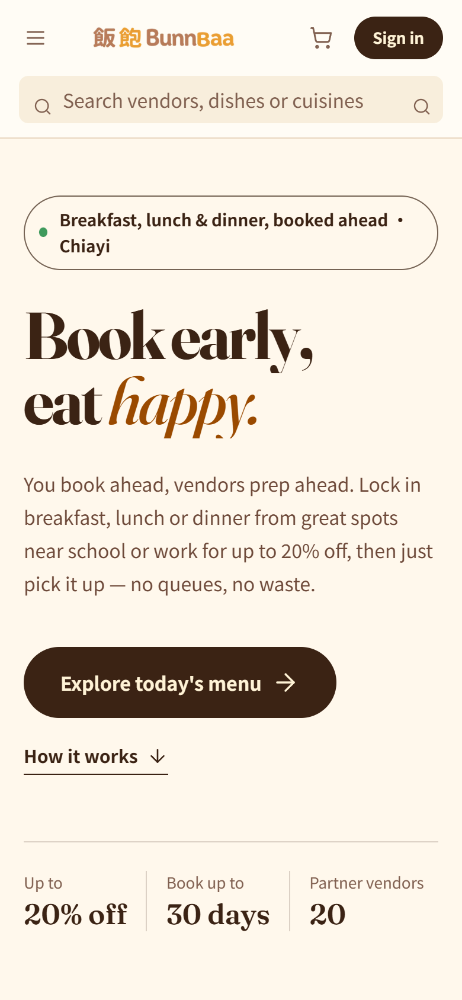
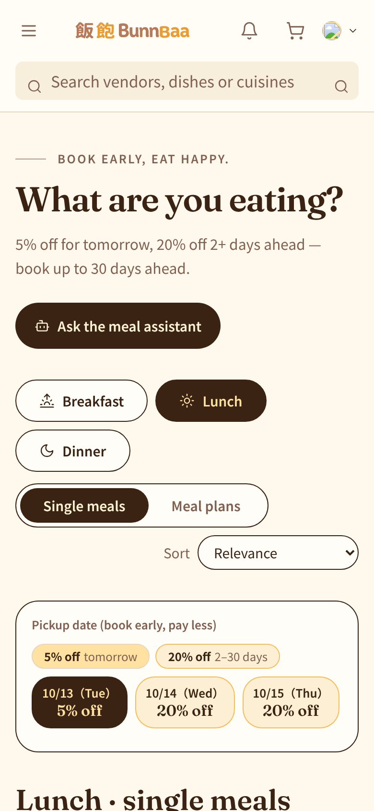
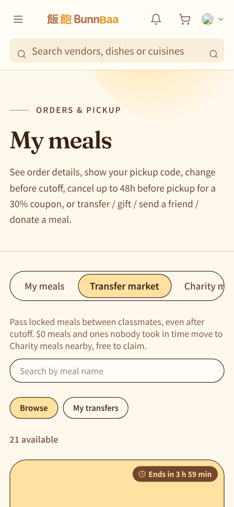
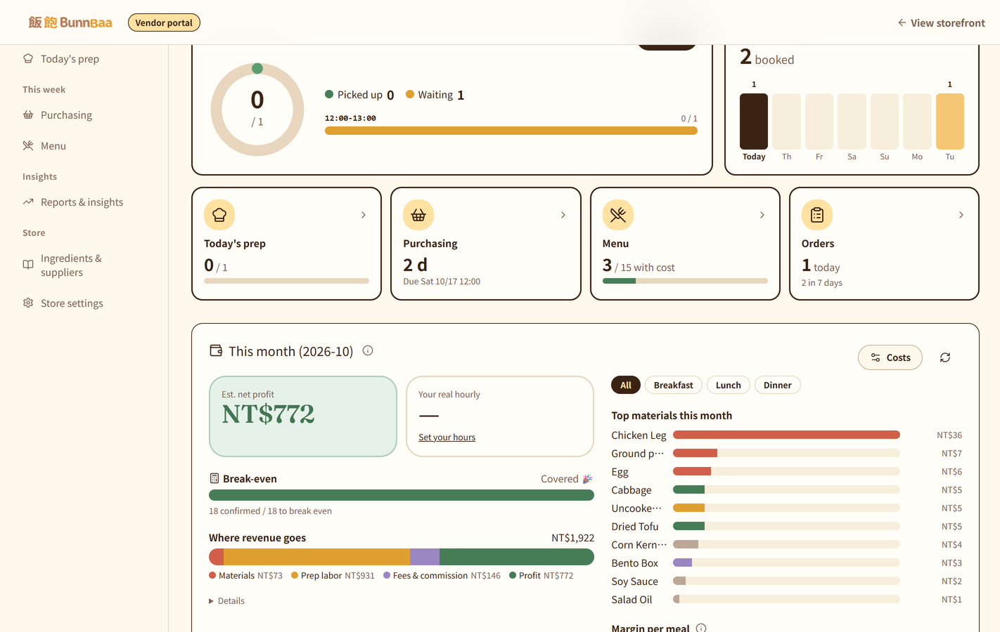
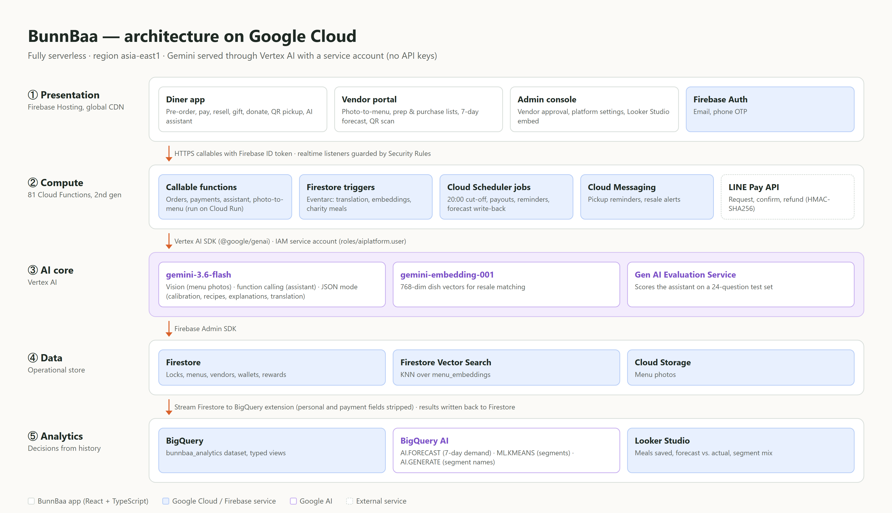
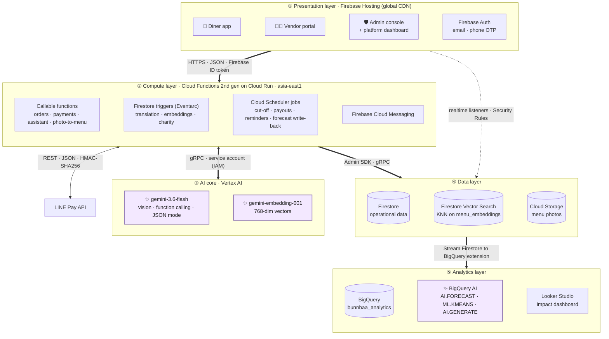
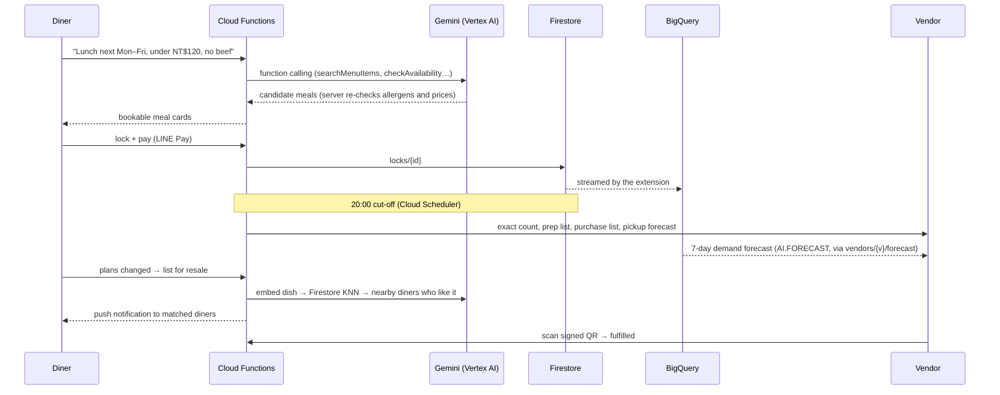

# BunnBaa 飯飽 — AI Pre-order Platform for Small Eateries

**English** | [中文](README.zh-TW.md)

> **Cook what's ordered. Eat what's cooked.**
> Diners pay ahead to lock a meal (the earlier they book, the cheaper it is), so small eateries know exactly what to cook. Gemini on Vertex AI then helps make sure every cooked meal finds someone to eat it, and BigQuery shows how much food was saved.


**Google AI Builder Cup 2026** · Theme: *Retail & Commerce: Intelligent Customer and Business Experiences* · Domain: **Sustainability** (food waste reduction)

| | |
|---|---|
| 🌐 **Live prototype** | https://bunnbaa-mvp-5474.web.app/?lang=en |
| 🎬 **Demo video (3 min)** | [YouTube link] |
| 📑 **Proposal deck** | [PDF link] |

### Try it

Open the live prototype. The interface is in English unless your browser is set to Chinese (`?lang=zh` / `?lang=en` switches it). Browsing menus needs no account. To book, resell or draw rewards, open **Sign in** and click the **Demo accounts** button, or sign in with the shared demo account below (it holds no real data):

| Role | Email | Password |
|---|---|---|
| Diner | `customer@bunnbaa.test` | `demo123` |
| Vendor | [demo vendor email] | [password] |

Payments run in the LINE Pay **sandbox**, so no real money moves.

---

## Screenshots

Diner app (mobile) and vendor portal, English UI. Taken on the local emulators with seeded demo data, so vendor and dish names are not translated yet; on production they are translated by Gemini.

<p>
  
  
  
</p>
<p></p>

## The problem

Small eateries near campuses and offices buy ingredients before anyone orders. If they guess high, food gets thrown away. If they guess low, customers get turned away. Diners queue every day with no guaranteed meal and no reward for deciding early. Even a prepaid meal goes to waste when its owner's plans change, because nobody else knows it is available.

This adds up. In 2022 the world wasted 1.05 billion tonnes of food, 19% of all food available to consumers, and 290 million tonnes of it was wasted in food service (UNEP, *Food Waste Index Report 2024*).

## How BunnBaa works

1. **Lock.** Diners book breakfast, lunch or dinner up to 30 days ahead and pay with LINE Pay. Booking two or more days early gets 20% off; booking for tomorrow gets 5% off.
2. **Cut-off.** At 20:00 the day before, the vendor gets an exact count, plus purchase and prep lists generated for them. A 7-day demand forecast from BigQuery helps them plan the days after that.
3. **Pass it on.** A diner who can't come can resell the meal, gift it, or donate it as a free charity meal. Meals nobody claims become charity meals automatically.
4. **Pick up.** The vendor scans a signed QR code at the counter.

Vendors pay no monthly fee. The platform keeps 5% of each meal sold, deducted at payout.

---

## Architecture



<sub>Source: [`assets/architecture.html`](assets/architecture.html). The same layers as a diagram GitHub renders:</sub>



✨ marks the points where AI is called. The five layers:

1. **Presentation.** Three web apps (diner, vendor, admin) share one React codebase on Firebase Hosting. They read Firestore directly through realtime listeners, and Security Rules decide what each user can see. Anything that changes money or stock goes through a callable function.
2. **Compute.** 80 Cloud Functions (2nd gen, running on Cloud Run) handle three kinds of work: callables that users trigger, triggers that react to Firestore writes, and jobs that Cloud Scheduler starts on a timer.
3. **AI core.** Every Gemini call goes through one wrapper (`functions/src/gemini.js`) to Vertex AI, authenticated with the functions' service account. The assistant runs a function-calling loop: Gemini asks for a tool, the function runs it against Firestore, and the result goes back to Gemini.
4. **Data.** Firestore holds all operational data. The menu vectors used for resale matching live in the same documents, with a Firestore vector index, so there is no separate vector database. Menu photos are in Cloud Storage.
5. **Analytics.** The official extension copies every Firestore write into BigQuery. BigQuery AI forecasts demand and groups diners into segments. A scheduled job writes the forecasts back to Firestore for the vendor portal, and Looker Studio reports the waste-reduction numbers.

### Security at each layer

| Layer | Protection |
|---|---|
| Presentation | Firebase Auth (email and password, or phone OTP with reCAPTCHA); Hosting sends `X-Frame-Options: DENY`, `nosniff`, a strict referrer policy and a CSP (currently report-only) |
| Compute | Callables check the Firebase ID token and the caller's role (admin or vendor owner); prices and discounts are recalculated on the server, never trusted from the client |
| AI core | Vertex AI is called with the service account's IAM role (`roles/aiplatform.user`), so there are no API keys. Allergens are filtered on the server, and the assistant can only show items its own tools returned |
| Data | Firestore and Storage Security Rules, covered by automated rule tests. Collections such as `payment_intents` and `lock_tokens` can only be written by Cloud Functions |
| Payments & pickup | LINE Pay requests are signed with HMAC-SHA256. Pickup QR codes are HMAC-signed and include an expiry time and a nonce, so a screenshot can't be reused |
| Analytics | BigQuery only gets the fields the analysis needs (no phone digits, notes or payment identifiers), and only admins can access the dataset |

### One meal, end to end



---

## AI features

### Gemini on Vertex AI: four points in a meal's life

| Stage | Feature | Gemini capability | Cloud Function |
|---|---|---|---|
| **List** | **Photo-to-menu.** A photo of a paper menu becomes structured, bilingual menu drafts (price, category, dietary tags, allergens). The owner confirms them before they go live. | Multimodal vision → JSON | `extractMenuFromImage` |
| **Find** | **Pre-order assistant.** A request like "Lunch next Mon–Fri, Da'an district, under NT$120, no beef" returns meal cards the diner can book. It also reads the BigQuery demand forecast and frequently-bought-together pairs (`getVendorInsights`) to put quieter vendors first and suggest add-ons. | Multi-turn function calling | `askShoppingAssistant` |
| **Rescue** | **Resale matching.** When a meal is listed for resale, BunnBaa finds nearby diners who have eaten similar dishes and sends them a push notification. | `gemini-embedding-001` + Firestore Vector Search KNN | `matchResaleLock` |
| **Calibrate** | **Pickup forecast.** The vendor sees a range like "42 locked → 38–41 expected", plus a nightly report in plain language and answers to what-if questions. | Structured JSON generation | `getPickupForecast`, `dailyCalibration`, `askCalibrationScenario` |

Gemini also explains the early-bird discount on the item page (`getDiscountExplanation`, cached per discount tier), drafts recipes, normalises dish names, and translates content between Chinese and English.

### BigQuery AI: what the data says

| Analysis | How | What it gives |
|---|---|---|
| **Demand forecast** | `AI.FORECAST` (TimesFM, no training needed) on the daily lock count for each vendor, 7 days ahead | "About N meals expected tomorrow (for reference)" in the vendor portal, written back to `vendors/{v}/forecast` |
| **Frequently bought together** | SQL self-join on items the same diner has bought from the same vendor (on any day; most orders hold a single item) | Item pairs the vendor can bundle, also used by the pre-order assistant |
| **Diner segments** | `ML.KMEANS` on recency, frequency and spend, plus resale rate and no-show rate | 4 segments of members with 2+ orders, retrained weekly; `AI.GENERATE` asks Gemini for a bilingual name and one-line description of each, e.g. "reliable early-bird multi-store regulars" |
| **Impact dashboard** | Admin console charts read the `bunnbaa_analytics` dashboard views through a Cloud Function; the same views back a Looker Studio report | Daily locks, forecast vs. actual, meals rescued, charity meals served, segment mix |

## Technical decisions

| Decision | Why |
|---|---|
| **Gemini on Vertex AI, authenticated with the service account** | There are no API keys to leak or rotate. Usage is billed per request on the Blaze plan, so the free-tier rate limits (429) that slow down a multi-step assistant don't apply. All calls go through one wrapper (`functions/src/gemini.js`, built on `@google/genai`), so switching providers meant changing one file. |
| **Gemini Flash for every text, vision and tool call** | Diners use the assistant while deciding what to eat, so it has to answer quickly. Flash is fast enough for that and can still handle multi-step function calling and reading menu photos. The same wrapper handles JSON mode and retries for every feature. |
| **Embeddings + Firestore Vector Search instead of a separate vector DB** | Menu vectors are stored in the same Firestore documents as the menu items, so there is no second database to keep in sync. The nearest-neighbour search runs in the same query as the distance and opt-out filters. |
| **Firestore for operations, BigQuery for analytics** | Firestore handles real-time bookings well but isn't built for analysing history. The official extension copies data into BigQuery without any code of our own, and forecasts go back to Firestore so the vendor portal stays a simple real-time app. |
| **TimesFM through `AI.FORECAST`** | A new vendor has little history, so there isn't enough data to train a per-vendor model. A pretrained time-series model gives usable forecasts on day one, with just one SQL query. |
| **Code calculates the numbers; Gemini only explains them** | Portions, prices, discounts, payouts, prize draws and vendor accuracy are all calculated by deterministic, tested functions. The model writes explanations of numbers it is given, so a hallucination can't change an amount of money. |
| **AI drafts, people decide** | Every AI output includes a `disclaimer` field. Owners confirm menus. Recipes drafted by AI stay flagged until the owner saves them. The demand forecast is labelled "for reference", not as an instruction. The assistant suggests meals but never places an order. |
| **Server-side guardrails** | The assistant can only show items that its own search tools returned in that turn. Allergens are filtered on the server twice: during search and again on the final cards. Prices are recalculated at checkout. |
| **Calm by design** | No urgency marketing. Each diner gets at most 30 assistant questions a day (answers are cached for 10 minutes) and at most 2 resale alerts a day. Alerts only go to diners within 10 km, and diners can turn them off with one tap. |
| **Privacy in the analytics layer** | BigQuery only gets the fields the analysis needs. Phone digits, free-text notes and payment identifiers stay out, and only admins can access the dataset. |
| **Fully serverless** | Cloud Functions (2nd gen, running on Cloud Run), Cloud Scheduler, Firestore and BigQuery all scale with demand and cost close to nothing when idle. That suits a platform whose traffic peaks around mealtimes. |

## Impact we measure

Each outcome is written to Firestore as it happens and streamed to BigQuery, so the numbers on the Looker Studio dashboard come from records rather than estimates:

- Meals rescued through AI matching (`claimed_by_match`)
- Meals resold and picked up (`resold_and_fulfilled`)
- Charity meals claimed (`charityReservations`)
- Forecast vs. actual demand per vendor, and vendor forecast accuracy for the "reliable" badge (`accuracy_reports`)

---

## Getting started

### Prerequisites

- Node.js 22 and `npm install -g firebase-tools`
- A Google Cloud / Firebase project on the **Blaze** plan
- These APIs enabled: **Vertex AI, BigQuery, Cloud Functions, Cloud Run, Cloud Build, Artifact Registry, Cloud Scheduler, Eventarc, Firestore, Cloud Storage, Firebase Auth, Firebase Cloud Messaging**
- The `roles/aiplatform.user` role granted to the Cloud Functions service account. Gemini authenticates with this role, so no API key is needed.
- A LINE Pay **Sandbox** channel ([pay.line.me/tw/developers](https://pay.line.me/tw/developers)), which you can create yourself without a merchant review

```bash
gcloud services enable aiplatform.googleapis.com bigquery.googleapis.com
gcloud projects add-iam-policy-binding <your-project-id> \
  --member="serviceAccount:<project-number>-compute@developer.gserviceaccount.com" \
  --role="roles/aiplatform.user"
```

### 1. Configure

```bash
git clone https://github.com/Donna12301230/bunnbaa-mvp.git && cd bunnbaa-mvp
firebase login
firebase use <your-project-id>

cd functions
cp .env.example .env   # fill in LINE_PAY_*, PICKUP_QR_SECRET, APP_BASE_URL
npm install

cd ../web && npm install
cd ../scripts && npm install
```

### 2. Set up the analytics layer

```bash
# The transform function strips personal and payment fields before rows reach BigQuery
firebase deploy --only functions:bqTransform
# Four extension instances (locks, menu_items, vendors, payment_intents), declared in firebase.json + extensions/*.env
firebase deploy --only extensions
```

Then backfill the existing documents, generate the typed views, and run `bigquery/sql/01_demand_forecast.sql` and `02_dashboard.sql`. The exact commands and IAM roles are in [`bigquery/README.md`](bigquery/README.md). The basket and segment SQL (`functions/src/customerInsights.sql`) runs weekly from a scheduled function.

### 3. Run locally with the emulators

```bash
# web/.env.local → VITE_USE_EMULATORS=true
npm run dev:emulator          # starts the emulators, loads seed data, then starts Vite
npm run dev:emulator:reset    # wipe local data and reload the seed data
```

To call Vertex AI from the emulator, run `gcloud auth application-default login` first.
Demo accounts (password `demo1234`): `customer@bunnbaa.test` (diner) and `vendor@bunnbaa.test` (vendor).

### 4. Deploy

```bash
cd web && npm run build && cd ..
firebase deploy --only firestore:rules,firestore:indexes,functions,hosting
```

When changes are merged to `master`, GitHub Actions deploys them automatically: `.github/workflows/firebase-functions-merge.yml` deploys the Cloud Functions and `firebase-hosting-merge.yml` deploys the website.

### 5. Test

```bash
cd scripts/tests
npm test                                          # business logic + Firestore security rules
npm run emulator                                  # separate emulator for Functions tests
npm run test:functions && npm run test:functions:more
```

Results as of 12 Oct 2026: all 64 business-logic tests, all 65 Firestore security-rule tests and all 144 Cloud Functions tests pass (tests that depend on the time of day are skipped when run too early, e.g. the two-cutoff `lockOrders` test needs to run after 20:00 Taipei time).

Pre-order assistant quality (`node scripts/eval/assistantEval.js`, 24 questions covering budgets, allergies, vegetarian, meal times, multi-day plans and English, 12 Oct 2026): 24/24 pass the rule checks (budget, allergens, excluded ingredients, meal period, weekday, no urgency wording) with zero allergen violations, and the **Vertex AI Gen AI Evaluation Service** scores fulfillment 4.79/5 and groundedness 4.96/5. Report: [`doc/evaluation/assistant-evaluation.md`](doc/evaluation/assistant-evaluation.md).

---

## Project structure

```
BunnBaa/
├── functions/src/          # Cloud Functions (Node 22, 2nd gen, asia-east1)
│   ├── gemini.js           # shared Gemini wrapper: Vertex AI, JSON mode, retry
│   ├── menuVision.js       # photo-to-menu
│   ├── shoppingAssistant.js# pre-order assistant (function calling)
│   ├── resaleMatch.js      # embeddings + vector KNN matching
│   ├── pickupForecast.js / vendorCalibration.js
│   ├── orders.js / linePay.js / wallet.js / charity.js / purchasing.js …
│   └── index.js            # wires up all callables, triggers and schedules
├── web/src/                # React + TypeScript + Vite + Tailwind
│   ├── pages/              # diner app
│   ├── pages/vendor-portal/
│   └── pages/admin/        # includes the platform dashboard (BigQuery views, drawn with Recharts)
├── bigquery/               # analytics SQL, schema views, setup steps
├── extensions/             # Stream Firestore to BigQuery instance configs
├── scripts/                # seed data, automated tests, assistant evaluation (eval/)
├── firestore.rules / firestore.indexes.json / storage.rules
└── doc/                    # specs, test plan, developer guide (Chinese)
```

Detailed developer notes (in Chinese), covering the data model, the full list of functions and environment details: [`doc/開發指南.md`](doc/開發指南.md). The Google Cloud design is in [`doc/AI與GoogleCloud設計.md`](doc/AI與GoogleCloud設計.md).

## Roadmap

- **Vertex AI Search** for semantic menu search ("light, with soup, no beef")
- Gemini-written summaries of reviews and no-shows for vendors
- Fraud signals (early-bird scalping, multiple accounts, gift loops), with Gemini case summaries for admins

## Team & license

Built by 鍾雅婷, 蘇雅雯 and 陳信喜 for the Google AI Builder Cup 2026.

Released under the [MIT License](LICENSE).
