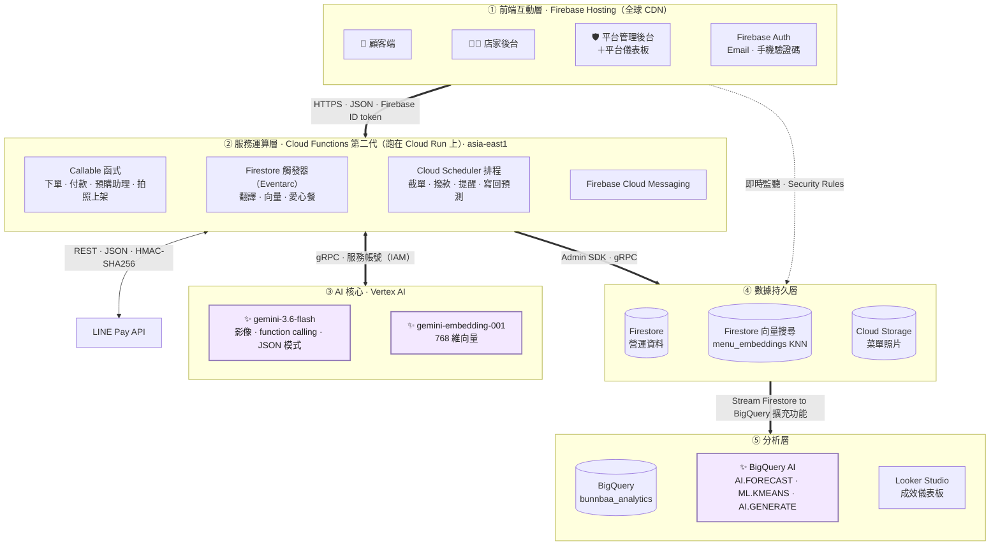
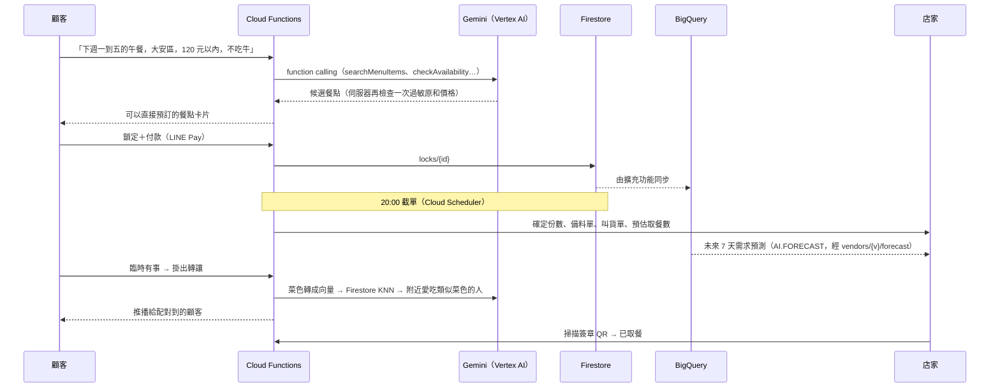

# BunnBaa 飯飽：小吃店的 AI 預購平台

[English](README.md) | **中文**

> **做多少，賣多少；煮出來的，都有人吃。**
> 顧客先付款鎖定餐點，越早訂越便宜，小吃店就能照確定的數量備餐。接著由 Vertex AI 上的 Gemini 幫每一份煮好的餐找到人吃，再用 BigQuery 算出實際少浪費了多少。


**Google AI Builder Cup 2026** · 賽題：*零售與商業：智慧客戶與商業體驗* · 領域：**永續 Sustainability**（減少剩食）

| | |
|---|---|
| 🌐 **線上版** | https://bunnbaa-mvp-5474.web.app |
| 🎬 **展示影片（3 分鐘）** | [YouTube 連結] |
| 📑 **提案簡報** | [PDF 連結] |

### 試用

打開線上版即可。瀏覽器是中文就顯示中文，其他語言顯示英文（網址加 `?lang=zh`／`?lang=en` 可切換）。瀏覽菜單不用登入；預購、轉讓、抽獎請到「登入」頁按「體驗帳號」一鍵登入，或用下面的共用示範帳號（上面沒有真實資料）：

| 角色 | Email | 密碼 |
|---|---|---|
| 消費者 | `customer@bunnbaa.test` | `demo123` |
| 商家 | `vendor@bunnbaa.test` | `demo1234` |

付款走 LINE Pay **Sandbox**，不會真的扣款。

---

## 畫面

消費者端（手機）與商家後台，英文介面。在本機 emulator 用示範資料截的，所以店名、菜名還沒翻譯；正式站上由 Gemini 自動翻成英文。

<p>
  
  
  
</p>
<p></p>

## 要解決的問題

學校和辦公區附近的小吃店，要在有人點餐之前就先叫貨。估太多，食材只能丟掉；估太少，客人買不到。顧客每天排隊，不保證買得到，也沒有因為早決定而得到好處。就算是已經付款的餐，只要訂的人臨時有事，別人也不知道有這份餐可以接手，最後還是浪費。

## 運作方式

1. **鎖定**：顧客最早可在 30 天前預訂早餐、午餐或晚餐，用 LINE Pay 付款。提早兩天以上訂打 8 折，訂明天的打 95 折。
2. **截單**：前一天 20:00 截單，店家拿到確定的份數，系統同時產生叫貨單和備料單。再往後幾天，則可以參考 BigQuery 算出的未來 7 天需求預測。
3. **轉手**：訂的人不能來，可以轉讓、送人，或捐成免費的愛心餐。沒人領的餐會自動變成愛心餐。
4. **取餐**：店家在櫃台掃描有簽章的 QR code 核銷。

店家不用付月費，平台從每份賣出的餐抽 5%，撥款時扣除。

---

## 系統架構


<sub>原始檔：[`assets/architecture.html`](assets/architecture.html)。下面是同一套分層的 Mermaid 版：</sub>



✨ 標示的是呼叫 AI 的地方。五層分別是：

1. **前端互動層**：顧客端、店家後台、管理後台共用一套 React 程式，放在 Firebase Hosting。畫面直接即時監聽 Firestore，每個人能看到什麼由 Security Rules 決定；牽涉金額或庫存的動作一律走 callable 函式。
2. **服務運算層**：81 支 Cloud Functions（第二代，跑在 Cloud Run 上）分三種：使用者觸發的 callable、Firestore 寫入時觸發的事件函式，以及 Cloud Scheduler 定時執行的排程。
3. **AI 核心**：所有 Gemini 呼叫都經過同一個 wrapper（`functions/src/gemini.js`）送到 Vertex AI，用 functions 的服務帳號認證。預購助理跑 function calling 迴圈：Gemini 要求呼叫工具，函式到 Firestore 查詢，再把結果交回 Gemini。
4. **數據持久層**：Firestore 存所有營運資料。轉讓媒合用的菜單向量存在同一份文件裡，搭配 Firestore 向量索引，不用另外架向量資料庫。菜單照片存在 Cloud Storage。
5. **分析層**：官方擴充功能把每一筆 Firestore 寫入同步到 BigQuery。BigQuery AI 預測需求、把顧客分群；排程把預測寫回 Firestore 給店家後台；Looker Studio 呈現減少剩食的數字。

### 各層的安全設計

| 層 | 保護方式 |
|---|---|
| 前端互動層 | Firebase Auth（Email 密碼，或手機驗證碼搭配 reCAPTCHA）；Hosting 送出 `X-Frame-Options: DENY`、`nosniff`、嚴格的 Referrer Policy 和 CSP（目前是 report-only） |
| 服務運算層 | Callable 會檢查 Firebase ID token 和呼叫者的角色（管理員或店主）；價格和折扣都在伺服器重算，不採信前端傳來的值 |
| AI 核心 | 用服務帳號的 IAM 角色（`roles/aiplatform.user`）呼叫 Vertex AI，沒有 API key。過敏原在伺服器端過濾，預購助理只能顯示自己的工具回傳的品項 |
| 數據持久層 | Firestore 和 Storage 的 Security Rules，有自動化規則測試。`payment_intents`、`lock_tokens` 這類 collection 只有 Cloud Functions 能寫 |
| 付款與取餐 | LINE Pay 請求用 HMAC-SHA256 簽章。取餐 QR 用 HMAC 簽章，並帶有效期限和 nonce，截圖不能重複使用 |
| 分析層 | BigQuery 只放分析需要的欄位（沒有電話末碼、備註、付款識別資料），dataset 只有管理員能存取 |

### 一份餐從頭到尾的流程



---

## AI 功能

### Vertex AI 上的 Gemini：一份餐的四個階段

| 階段 | 功能 | 用到的 Gemini 能力 | Cloud Function |
|---|---|---|---|
| **上架** | **拍照上架**：拍一張紙本菜單，產生結構化的中英文品項草稿（價格、分類、飲食標籤、過敏原）。店家確認後才會上架。 | 多模態影像 → JSON | `extractMenuFromImage` |
| **找餐** | **預購助理**：輸入「下週一到五的午餐，大安區，120 元以內，不吃牛」，回傳可以直接預訂的餐點卡片。也會讀 BigQuery 的需求預估與常一起買（`getVendorInsights`），把預估較不擁擠的店排前面、建議可以加點什麼。 | 多輪 function calling | `askShoppingAssistant` |
| **救餐** | **轉讓媒合**：有人掛出轉讓時，找出附近吃過類似菜色的顧客並推播通知。 | `gemini-embedding-001`＋Firestore 向量搜尋 KNN | `matchResaleLock` |
| **校準** | **預估取餐數**：店家看到「鎖定 42 份 → 預估 38–41 份會來取」這樣的區間，每晚另有一份白話報告，也可以追問「如果……會怎樣」。 | 結構化 JSON 生成 | `getPickupForecast`、`dailyCalibration`、`askCalibrationScenario` |

Gemini 也負責在品項頁說明早鳥折扣（`getDiscountExplanation`，依折扣級距快取）、產生配方草稿、統一菜名，以及中英文內容互譯。

### BigQuery AI：從資料看出什麼

| 分析 | 做法 | 產出 |
|---|---|---|
| **需求預測** | 對每家店每天的鎖定量跑 `AI.FORECAST`（TimesFM，不用訓練），預測未來 7 天 | 店家後台顯示「預估明天約 N 份（參考）」，寫回 `vendors/{v}/forecast` |
| **常一起買** | 用 SQL self-join 找同一位顧客在同一家店都買過的品項（不限同一天，因為一筆訂單多半只有一個品項） | 店家可以拿來搭配套餐，預購助理也會參考 |
| **顧客分群** | 用最近一次消費、頻率、金額，加上轉讓率、爽約率，跑 `ML.KMEANS` | 買過 2 份以上的會員分成 4 群，每週重新訓練；再用 `AI.GENERATE` 請 Gemini 為每群取中英文群名、寫一句說明，例如「高履約早鳥跨店客」 |
| **成效儀表板** | 平台管理後台透過 Cloud Function 讀 `bunnbaa_analytics` 的儀表板 view 自己畫圖；同一組 view 也接 Looker Studio 報表 | 每日鎖定量、預測與實際對照、救回的餐數、送出的愛心餐數、客群分布 |

## 技術決策

| 決策 | 原因 |
|---|---|
| **Gemini 改走 Vertex AI，用服務帳號認證** | 沒有 API key，也就不怕外洩、不用輪替。Blaze 方案按用量計費，不會碰到免費層的限流（429），多輪對話的預購助理不會被卡住。所有呼叫都經過同一個 wrapper（`functions/src/gemini.js`，使用 `@google/genai`），換供應商只要改這一個檔。 |
| **文字、影像、工具呼叫都用 Gemini Flash** | 顧客是在決定要吃什麼的當下用助理，回應一定要快。Flash 夠快，也能處理多步驟的 function calling 和讀菜單照片。所有功能共用同一個 wrapper 處理 JSON 模式和重試。 |
| **向量直接存在 Firestore，不另外架向量資料庫** | 菜單向量跟品項存在同一份 Firestore 文件裡，不用同步第二個資料庫。最近鄰搜尋跟距離、關閉通知等條件在同一個查詢裡完成。 |
| **營運用 Firestore，分析用 BigQuery** | Firestore 很適合處理即時預訂，但不適合分析歷史資料。官方擴充功能不用寫程式就能把資料同步到 BigQuery；預測結果再寫回 Firestore，店家後台維持單純的即時應用。 |
| **用 `AI.FORECAST`（TimesFM）做預測** | 新店家的歷史資料很少，不夠替每家店各訓練一個模型。預先訓練好的時間序列模型從第一天就能給出可用的預測，而且只要一段 SQL。 |
| **數字由程式算，Gemini 只負責解釋** | 份數、價格、折扣、撥款、抽獎和店家準確率，全部由有測試的確定性函式計算。模型只解釋給它的數字，就算它產生錯誤內容，也改不了任何金額。 |
| **AI 給草稿，人來決定** | 每個 AI 輸出都帶 `disclaimer` 欄位。菜單要店家確認。AI 產生的配方在店家存檔前一直標示為草稿。需求預測標明「參考」，不是指令。預購助理只推薦，不會替顧客下單。 |
| **伺服器端把關** | 助理只能顯示它這一輪自己的搜尋工具回傳的品項。過敏原在伺服器端過濾兩次：搜尋時一次，最後的卡片再一次。結帳時重新計算價格。 |
| **不催促消費** | 沒有限時搶購這類話術。每人每天最多問助理 30 次（答案快取 10 分鐘），每天最多收到 2 則轉讓通知。只通知 10 公里內的人，一鍵就能關閉。 |
| **分析層的個資保護** | BigQuery 只放分析需要的欄位。電話末碼、備註文字和付款識別資料都不同步，dataset 只有管理員能存取。 |
| **全部 serverless** | Cloud Functions（第二代，跑在 Cloud Run 上）、Cloud Scheduler、Firestore 和 BigQuery 都會隨用量擴展，沒人用的時候幾乎不花錢。很適合流量集中在用餐時段的平台。 |

## 我們怎麼衡量成效

每個結果發生時都會寫進 Firestore 並同步到 BigQuery，所以 Looker Studio 儀表板上的數字來自實際紀錄，不是估算：

- 透過 AI 媒合救回的餐（`claimed_by_match`）
- 轉讓後被取走的餐（`resold_and_fulfilled`）
- 被領取的愛心餐（`charityReservations`）
- 各店家的預測與實際需求對照，以及「準時可靠」標章用的預估準確率（`accuracy_reports`）

---

## 快速開始

### 前置需求

- Node.js 22，並執行 `npm install -g firebase-tools`
- 使用 **Blaze** 方案的 Google Cloud／Firebase 專案
- 啟用這些 API：**Vertex AI、BigQuery、Cloud Functions、Cloud Run、Cloud Build、Artifact Registry、Cloud Scheduler、Eventarc、Firestore、Cloud Storage、Firebase Auth、Firebase Cloud Messaging**
- 替 Cloud Functions 的服務帳號加上 `roles/aiplatform.user` 角色。Gemini 用這個角色認證，不需要 API key。
- LINE Pay **Sandbox** channel（[pay.line.me/tw/developers](https://pay.line.me/tw/developers)），不用商家審核，可以自己申請

```bash
gcloud services enable aiplatform.googleapis.com bigquery.googleapis.com
gcloud projects add-iam-policy-binding <your-project-id> \
  --member="serviceAccount:<project-number>-compute@developer.gserviceaccount.com" \
  --role="roles/aiplatform.user"
```

### 1. 設定

```bash
git clone https://github.com/Donna12301230/bunnbaa-mvp.git && cd bunnbaa-mvp
firebase login
firebase use <your-project-id>

cd functions
cp .env.example .env   # 填入 LINE_PAY_*、PICKUP_QR_SECRET、APP_BASE_URL
npm install

cd ../web && npm install
cd ../scripts && npm install
```

### 2. 建立分析層

```bash
# transform function：資料寫進 BigQuery 前先拿掉個資與付款識別欄位
firebase deploy --only functions:bqTransform
# 4 個擴充功能實例（locks、menu_items、vendors、payment_intents），設定在 firebase.json 與 extensions/*.env
firebase deploy --only extensions
```

接著回填既有資料、產生有型別的 view，再執行 `bigquery/sql/01_demand_forecast.sql` 和 `02_dashboard.sql`。完整指令與 IAM 權限見 [`bigquery/README.md`](bigquery/README.md)。購物籃與分群的 SQL（`functions/src/customerInsights.sql`）由排程函式每週執行。

### 3. 用 emulator 在本機執行

```bash
# web/.env.local → VITE_USE_EMULATORS=true
npm run dev:emulator          # 啟動 emulator、灌種子資料，再開 Vite
npm run dev:emulator:reset    # 清掉本機資料，重新灌種子資料
```

要在 emulator 裡呼叫 Vertex AI，先執行 `gcloud auth application-default login`。
測試帳號（密碼 `demo1234`）：`customer@bunnbaa.test`（顧客）、`vendor@bunnbaa.test`（店家）。

### 4. 部署

```bash
cd web && npm run build && cd ..
firebase deploy --only firestore:rules,firestore:indexes,functions,hosting
```

合併到 `master` 時，GitHub Actions 會自動部署：`.github/workflows/firebase-functions-merge.yml` 部署 Cloud Functions，`firebase-hosting-merge.yml` 部署網站。

### 5. 測試

```bash
cd scripts/tests
npm test                                          # 商業邏輯＋Firestore 安全規則
npm run emulator                                  # Functions 測試專用的 emulator
npm run test:functions && npm run test:functions:more
```

2026-10-13 的結果：商業邏輯測試 64 項、Firestore 安全規則測試 65 項、Cloud Functions 測試 151 項全部通過（跟時間有關的測試在時間不到時會跳過，例如兩家不同截單時間的 `lockOrders` 要台北時間 20:00 後才能跑）。

預購助理回答品質（`node scripts/eval/assistantEval.js`，24 題，涵蓋預算、過敏、素食、餐期、多日方案與英文提問，2026-10-12）：規則檢查（預算、過敏原、不吃的食材、餐期、星期、不催促）24/24 通過、過敏原違規 0；**Vertex AI Gen AI Evaluation Service** 評分需求符合度 4.79/5、有據性 4.96/5。報告：[`doc/evaluation/預購助理回答品質評估.md`](doc/evaluation/預購助理回答品質評估.md)。

---

## 專案結構

```
BunnBaa/
├── functions/src/          # Cloud Functions（Node 22，第二代，asia-east1）
│   ├── gemini.js           # 共用的 Gemini wrapper：Vertex AI、JSON 模式、重試
│   ├── menuVision.js       # 拍照上架
│   ├── shoppingAssistant.js# 預購助理（function calling）
│   ├── resaleMatch.js      # 向量＋KNN 轉讓媒合
│   ├── pickupForecast.js / vendorCalibration.js
│   ├── orders.js / linePay.js / wallet.js / charity.js / purchasing.js …
│   └── index.js            # 所有 callable、觸發器和排程都在這裡接線
├── web/src/                # React + TypeScript + Vite + Tailwind
│   ├── pages/              # 顧客端
│   ├── pages/vendor-portal/
│   └── pages/admin/        # 包含平台儀表板（BigQuery view，用 Recharts 畫）
├── bigquery/               # 分析用 SQL、schema view、建置步驟
├── extensions/             # Stream Firestore to BigQuery 實例設定
├── scripts/                # 種子資料、自動化測試、預購助理評估（eval/）
├── firestore.rules / firestore.indexes.json / storage.rules
└── doc/                    # AI 與 Google Cloud 設計、助理評估
```

AI 與 Google Cloud 的設計：[`doc/AI與GoogleCloud設計.md`](doc/AI與GoogleCloud設計.md)。

## 後續規劃

- **Vertex AI Search**：品項語意搜尋（「清淡、有湯、不要牛」）
- 用 Gemini 為店家整理評論與爽約情況的摘要
- 詐騙訊號（早鳥囤貨轉賣、多重帳號、互相贈送洗單），並用 Gemini 為管理員整理案件摘要

## 團隊與授權

由鍾雅婷、蘇雅雯、陳信喜為 Google AI Builder Cup 2026 打造。

授權：[MIT License](LICENSE)
