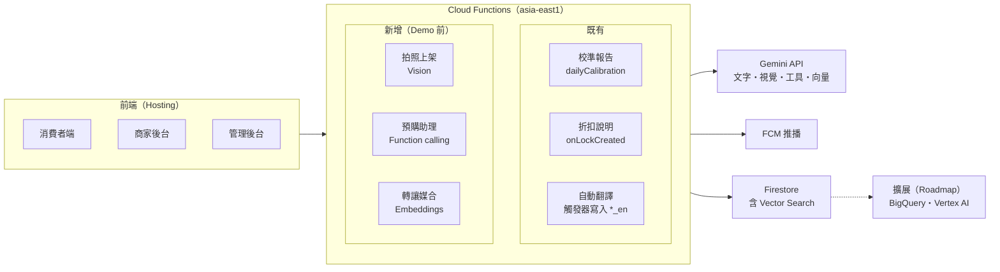

# BunnBaa AI 功能設計（Google AI Builder Cup）

2026-09-29 · 參賽組別：Retail & Commerce — Intelligent Customer and Business Experiences

線上文件版：https://claude.ai/code/artifact/016e4b6f-f787-4fac-a45d-620138aa7ffb

---

## 參賽故事線

BunnBaa 以「上架 → 找餐 → 救餐 → 校準」四段 AI 循環參加 Retail & Commerce 組，核心主張是讓小型餐飲業者**事先知道要備多少、剩下的也有人接手**。

BunnBaa 本身已經回應了題目中的需求預測與庫存：消費者先付款鎖定，商家事先知道份數，就能減少浪費。目前已上線的 AI 功能（商家校準報告、消費者折扣說明、Gemini 自動翻譯）偏向輔助角色。新設計把 AI 串成一個完整的循環：

1. **上架**：AI 協助小店在幾分鐘內把紙本菜單變成結構化的線上商品
2. **找餐**：消費者用一句話描述需求，AI 找出符合條件、還有名額的預購
3. **救餐**：有人無法取餐時，AI 把這份餐媒合給可能想接手的人
4. **校準**：實際取餐結果回到商家端，變成下一輪的備料參考區間

**負責任 AI 原則（沿用現有設計）**：AI 不輸出決策指令，輸出固定帶 `disclaimer` 欄位，最後由人決定。AI 不幫消費者下單，也不替商家決定備貨量；價格一律由伺服器重算。這直接回答「AI 建議錯了誰負責」，要放進 Proposal 的 Responsible AI 段落。

## AI 功能總覽

共六項功能，其中前三項在 10/18 Demo 前實作，第 4 項做一部分，後兩項寫進 Roadmap。

| # | 功能 | 對應題目 | 建在哪裡 | Demo 前 |
| --- | --- | --- | --- | --- |
| 1 | 拍照上架菜單（多模態） | Discovery、營運效率 | `VendorPortalMenu` → `menu_items` | 實作 |
| 2 | 對話式預購助理 | Conversational shopping、Personalization | `HomePage` → 新 callable | 實作 |
| 3 | 轉讓智慧媒合 | Inventory、減少浪費 | `locks` 轉成 `for_resale` 時觸發 → FCM | 實作 |
| 4 | 備料預測區間（強化現有校準） | Demand planning | `vendorCalibration.js` → `VendorPortalPrep` | 部分（加上區間顯示） |
| 5 | 評論與未取餐洞察 | Customer insights | `reviews` 加上 no-show 備註 | Roadmap |
| 6 | 異常行為偵測、申訴摘要 | Fraud | `locks`、`ban_appeals` → 管理後台 | Roadmap |

## 各功能設計

### 1. 拍照上架菜單（Gemini Vision）

店主拍紙本菜單或餐點照片，AI 產出商品草稿，店主確認後才上架。

- 新增 callable `extractMenuFromImage`，Gemini 回傳 JSON：`name`、`name_en`、`price`、`category`、`dietary_tags`、`allergens`、`description`
- 結果只是預填草稿，店主確認後才寫進 `menu_items`
- 關鍵：`seed.js` 的 `dietary_tags` 目前都是空陣列。有了這個功能才有結構化標籤，功能 2 的「不吃牛、素食」篩選才做得到
- 影響：小店不用手動輸入就能上架，這是可擴展性的論點（接一家新店的成本趨近於零）

### 2. 對話式預購助理（Gemini Function Calling）

消費者用一句話描述需求，例如「下週一到五中午，大安區，預算 120，不吃牛」，助理回傳候選卡片。

- 新增 callable `askShoppingAssistant`，Gemini 可呼叫的工具（查詢都在伺服器端執行，Gemini 不直接碰 Firestore）：
    - `searchMenuItems(city, district, category, maxPrice, dietaryTags)`：查 `menu_items`
    - `checkAvailability(vendorId, date, window)`：查 `slot_counters` 與公休日
    - `searchMealPlans(...)`：查 `meal_plans`，對應「一週五天」這類需求
- 回傳候選卡片，連到 `MenuItemPage` 或加入計畫。**助理不下單**，付款仍走原本的 LINE Pay 流程，價格由伺服器重算
- 語氣沿用 `consumerExplanation.js`：不催促、不行銷
- 前端用 `ds/BottomSheet` 做對話框，中英文依 `lang` 切換（Functions 已有 `AsyncLocalStorage`）

### 3. 轉讓智慧媒合（Embeddings + Firestore Vector Search）

鎖定轉成 `for_resale` 時，找出可能想接手的會員並推播通知。

- 比對條件：同地區、取餐時段相近、過去鎖定過類似品項
- `menu_items` 存 Gemini embedding，用 Firestore 原生 KNN 向量搜尋，再用現有 FCM 推播
- 影響指標可直接從現有資料計算：`resold_and_fulfilled` 的數量 = 救回的份數。這是 Proposal 裡最有說服力的社會影響數字

### 4. 備料預測區間（強化現有校準）

把 `accuracy_reports` 的 `error_range` 變成備料頁上的數字區間，例如「已鎖定 42 份，依歷史 no-show 率，預估實際取餐 38–41 份」（數字為示意）。

- 區間用一般統計計算，不交給 LLM 算數字；Gemini 只負責白話說明
- 現有的 `askCalibrationScenario` what-if 追問直接接上

### 5. 評論與未取餐洞察（Roadmap）

每週把 `reviews` 與 no-show 備註彙整成品項層級的主題與情緒，放進 `VendorPortalReports`。

### 6. 異常行為偵測、申訴摘要（Roadmap）

- 辨識模式：低價搶早鳥再高價轉讓、同一手機多個帳號、贈送來回互轉
- Gemini 為每個案件寫摘要，由管理員判斷；`ban_appeals` 先自動整理，再交管理員核准
- 現有「未取餐 2 次自動封鎖」可當作第一版規則

## 架構、可行性與可擴展性

新功能都只是在 `functions/src/` 多加模組，共用現有的 `gemini.js`（已有 503／429 重試），不需要改資料架構。

- **可行性**：正式站已上線，包含 21 支 Functions、LINE Pay 端到端付款、中英雙語、QR 核銷
- **可擴展性**：
    - 資料層：Firestore → BigQuery（官方 Extension），之後把預測換成 Vertex AI 或 BigQuery ML
    - 多語言已自動化，擴展到其他城市、國家的成本很低
    - 地區篩選已有縣市＋鄉鎮市區
    - 拍照上架讓接一家新店的成本趨近於零
- **Google 技術棧**：Gemini（文字、視覺、function calling、embeddings）、Firebase、Firestore Vector Search、FCM、Cloud Scheduler，全部是 Google 服務，與比賽方向一致

## 風險與時程

建議先做功能 1 和 3（各約 1–2 天），功能 2 最後做；時間不夠時，功能 2 只做單輪問答。

- **免費層限流**：Gemini 目前用免費層 key，功能 2 的多輪對話加 function calling 容易碰到 429。Demo 前要為常見查詢加快取（參考 `discount_explanations`），或 Demo 當天換有額度的 key
- **時程**：10/18 前還有不少正式站驗證項目（見 `TODO.md`），AI 功能不能排擠整合測試與錄 Demo
- **統計數字**：Proposal 中台灣餐飲浪費量等數字要找有出處的資料，不要自行估計

下一步：

- [ ] 實作功能 1：拍照上架菜單（補上 `dietary_tags`）
- [ ] 實作功能 3：轉讓智慧媒合
- [ ] 實作功能 2：對話式預購助理
- [ ] 備料頁加上預測區間
- [ ] 整理成英文 Proposal 投影片並匯出 PDF
