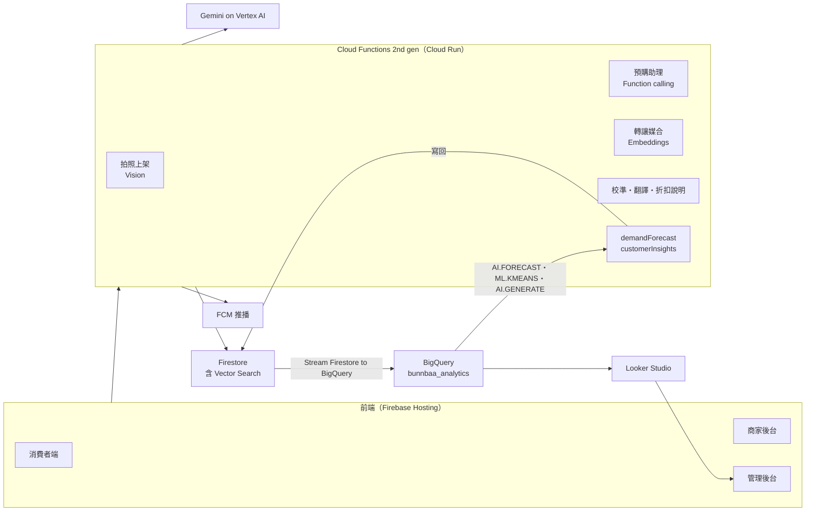

# BunnBaa AI 與 Google Cloud 設計

Google AI Builder Cup 2026 · Retail & Commerce — Intelligent Customer and Business Experiences

本文件說明 AI 功能與 Google Cloud 分析層的設計和實作現況（2026-10-12）。BigQuery SQL 見 [`bigquery/README.zh-TW.md`](../bigquery/README.zh-TW.md)，助理評估見 [evaluation/](evaluation/)。

---

## 1. 故事線與負責任 AI 原則

BunnBaa 以「上架 → 找餐 → 救餐 → 校準」四段 AI 循環，讓小型餐飲業者**事先知道要備多少、剩下的也有人接手**：

1. **上架**：AI 協助小店在幾分鐘內把紙本菜單變成結構化的線上商品
2. **找餐**：消費者用一句話描述需求，AI 找出符合條件、還有名額的預購
3. **救餐**：有人無法取餐時，AI 把這份餐媒合給可能想接手的人
4. **校準**：實際取餐結果回到商家端，變成下一輪的備料參考區間；BigQuery AI 再預測未來 7 天份數

**負責任 AI 原則**：AI 不輸出決策指令，輸出固定帶 `disclaimer` 欄位，最後由人決定。AI 不幫消費者下單，也不替商家決定備貨量；價格一律由伺服器重算；**任何數字（價格、份量、準確率、預測）都由程式或 BigQuery 計算，模型只負責說明給它的數字**。

## 2. AI 功能總覽

目前上線的 Gemini 功能共 9 項，另有 BigQuery AI 3 項：

| 功能 | 後端 | 前端 | 技術 |
| --- | --- | --- | --- |
| 拍照上架菜單 | `menuVision.js`：`extractMenuFromImage` | 菜單管理「拍照上架」 | Gemini Vision |
| 對話式預購助理 | `shoppingAssistant.js`：`askShoppingAssistant` | 首頁「計畫工具箱」→ `ShoppingAssistant.tsx` | Gemini function calling |
| 轉讓智慧媒合 | `resaleMatch.js`：`embedMenuItem`、`matchResaleLock` | FCM 推播；會員中心可關閉 | Gemini embedding＋Firestore Vector Search |
| 預估取餐區間 | `pickupForecast.js`：`getPickupForecast` | 每日備料頁「預估實際取餐」 | 純統計（不用 LLM） |
| 校準報告與 what-if | `vendorCalibration.js` | 商家報表 | 程式算數字＋Gemini 說明 |
| 折扣說明 | `getDiscountExplanation` | 品項頁金額明細 | Gemini |
| 配方草稿／AI 一次補完、菜名歸類 | 配方相關 callable | 配方頁 | Gemini |
| 自動翻譯 | 觸發器寫入 `*_en` 欄位 | 英文介面 | Gemini |
| 需求預測（7 天） | `demandForecast.js` | 商家營收頁 `DemandForecastCard` | BigQuery `AI.FORECAST`（TimesFM） |
| 客群與常一起買 | `customerInsights.js`＋`.sql` | `CustomerInsightsCard`、品項頁「常一起買」 | `ML.KMEANS`＋`AI.GENERATE` |
| 平台儀表板 | `bigquery/sql/02_dashboard.sql`＋`platformDashboard.js` | 管理後台 `/admin/analytics` | BigQuery view；同一組 view 也接 Looker Studio |

Roadmap（未實作）：評論與未取餐洞察（每週彙整 `reviews` 與 no-show 備註成品項主題）、異常行為偵測與申訴摘要（目前 `detectAnomalies` 是規則版）、Vertex AI Search 語意搜尋（現有 Firestore KNN 已夠用）。

## 3. 各功能設計

### 3.1 拍照上架菜單

店主拍紙本菜單或餐點照片（≤ 4 MB），Gemini 回傳 JSON 草稿：`name`、`name_en`、`price`、`category`、`dietary_tags`、`allergens`、`description`。草稿按「填入表單」後由店主確認才寫進 `menu_items`。飲食標記、過敏原只保留固定選項；過敏原是依品名推測，風險在漏標，表單要求店主逐項確認。

### 3.2 對話式預購助理

消費者一句話描述需求（例：「下週一到五中午，大安區，預算 120，不吃牛」），助理回傳候選卡片。Gemini 只能呼叫伺服器端工具，不直接碰 Firestore：

- `searchMenuItems`（地區、類別、預算、飲食標記、`mealPeriod` 早／午／晚）
- `checkAvailability`（`slot_counters` 與公休日）
- `searchMealPlans`（多日方案）
- `getVendorInsights`：讀 `vendors/{v}/forecast` 與 `analytics/basket`，回傳各店預估份數、相對平常 busier／typical／quieter、常一起買
- `presentCandidates`：交回卡片，可帶 `reasons: [{ id, reason }]`

把關：

- 卡片只接受這一輪搜尋工具回傳過的品項，查無或下架的丟掉；價格由伺服器依早鳥規則重算，結帳時再算一次。**助理不下單**，付款走原本的 LINE Pay 流程
- 會員設定的過敏原在伺服器端過濾，卡片輸出前再濾一次，不靠模型記得
- 推薦理由（`cardReason`）只收這一輪 `getVendorInsights` 有查到資料的店，中文 20 字內／英文 40 字元內，有催促字眼就丟掉
- `runWithTools` 最多 7 輪，最後一輪限定只能呼叫 `presentCandidates`
- 限流：每人每天 30 次（`users.assistant_usage`），相同問題 10 分鐘內回快取（`assistant_cache`）
- 語氣沿用 `consumerExplanation.js`：不催促、不行銷

品質評估見 [evaluation/assistant-evaluation.md](evaluation/assistant-evaluation.md)：24 題規則檢查 24/24、過敏原違規 0、Vertex AI Gen AI Evaluation Service 需求符合度 4.79/5、有據性 4.96/5（2026-10-12）。

### 3.3 轉讓智慧媒合

鎖定轉成 `for_resale` 時，找出可能想接手的會員並推播。

- 品項寫入就算向量（768 維 `gemini-embedding-001`），存 `menu_embeddings`；管理員可用 `backfillMenuEmbeddings` 補算
- 排序：Firestore KNN 找同縣市相似品項（cosine）→ 過去鎖定過這些品項的會員 → 依相似度、同店、取餐時段相近加權。排除轉讓者、曾經持有者、當天已訂這家店的人
- 限流：每人每天最多 2 則，常用地點離店 10 公里以上不通知，同一筆取消後重新上架 12 小時內不重複通知
- 影響指標：`resale_matches/{lockId}` 記下通知了誰；付費接手者是被通知的會員時記 `claimed_by_match: true`，可算出「媒合救回的份數」

### 3.4 預估取餐區間與校準

- 預估區間：過去 60 天、每天至少 3 份的日子算取餐率；同星期幾的資料滿 4 天就只用同星期幾。8 天以上取 10%／90% 分位數，不到 8 天用平均 ± 1.28 標準差
- 校準報告的 `accuracy_rate`、`error_range` 由 `calibrationStats` 用程式算（Σ取餐÷Σ鎖定、平均落差），準確率決定消費者看到的「穩定」徽章；Gemini 只拿算好的數字寫說明，失敗時照樣寫入數字。what-if 追問（`answerCalibrationScenario`）只回答問題
- AI 補完的配方份量在店家確認前，今日備料、叫貨頁會顯示 `AiDraftWarning`，傳 LINE 叫貨前先確認

## 4. Google Cloud 架構

### 4.1 Gemini on Vertex AI

所有模組都透過 `functions/src/gemini.js` 呼叫，用 `@google/genai`（Vertex 模式），服務帳號認證、不需要 API key。

- 端點預設 `global`（`VERTEX_LOCATION` 可覆蓋），模型 `gemini-3.6-flash`；embedding 維持 768 維，否則 `firestore.indexes.json` 的向量索引會失效
- 權限：Functions 預設服務帳號 `roles/aiplatform.user`；Evaluation Service 的服務代理（`gcp-sa-vertex-eval`）也加了同一角色
- `withRetry` 處理 503／429；本機 emulator 用 `GEMINI_DISABLED=1` 關掉 Gemini

### 4.2 Firestore → BigQuery

官方 Extension **Stream Firestore to BigQuery**，`locks`、`menu_items`、`vendors`、`payment_intents` 各一個實例（設定在 `firebase.json` 與 `extensions/bq-*.env`），dataset `bunnbaa_analytics`（asia-east1）。

- 個資：transform function `bqTransform`（`functions/src/bigqueryExport.js`）在寫入前拿掉手機、備註、交易序號、取餐碼；`buyer_uid` 保留供分群。dataset 只開給管理員
- SQL 都查 `fs-bq-schema-views` 產生的型別 view（`{表}_schema_{schema 檔名}_latest`）

### 4.3 需求預測（`AI.FORECAST`）

- `bigquery/sql/01_demand_forecast.sql`：`daily_demand`（每店每日份數，取消的不算）、`demand_forecast`、`forecast_vs_actual`、14 天回測
- 種子資料歷史太短，BigQuery 內產生 90 天模擬背景需求（`demand_history_sim`，含星期效應、雨天、成長、雜訊）疊加在真實份數上，不寫進 Firestore
- `demandForecast.js` 每天 05:00 寫回 `vendors/{v}/forecast/{日期}`，畫面固定標示「僅供參考，不是備料指令」。回測平均誤差 11%

### 4.4 購物籃與客群（`ML.KMEANS`、`AI.GENERATE`）

`customerInsights.js` 每週一 04:00 跑（管理員可用 `triggerCustomerInsightsNow` 重跑）：

- 購物籃：同一位客人在同一家店都買過的品項配對，寫回 `vendors/{v}/analytics/basket` 與 `menu_items/{id}.often_with`（內容沒變不寫）
- 分群：過去 90 天買過 2 份以上的會員，以 RFM＋轉讓率＋爽約率分 4～5 群；`AI.GENERATE` 產生中英文群名與描述，欄位不完整的群組重試一次。只寫彙總數字，不寫 `buyer_uid`

### 4.5 平台儀表板（Looker Studio）

`bigquery/sql/02_dashboard.sql` 建立 `dash_daily_ops`、`dash_forecast_vs_actual`、`dash_forecast_next`、`dash_segments`。管理後台「平台儀表板」（`/admin/analytics`）呼叫 `getPlatformDashboard`（限管理員）即時查這四個 view，用 Recharts 畫總數卡、每日預訂與救回、預測 vs 實際、未來預估、客群表（英文介面用 `label_en`）。同一組 view 也接 Looker Studio 報表，頁面上有「在 Looker Studio 開啟」按鈕，網址存在 `platformConfig/analytics.lookerStudioEmbedUrl`。目前數字：3,659 份裡救回 408 份（轉讓 296＋愛心餐 112），全平台預測誤差（WAPE）6～15%。

### 4.6 前端讀取格式

型別定義在 `web/src/lib/analytics.ts`。這些文件都由後端用 Admin SDK 寫入。

| 用途 | 路徑 | 欄位 |
|---|---|---|
| 需求預測 | `vendors/{v}/forecast/{YYYY-MM-DD}` | `day`、`forecast`、`lower`、`upper`、`model`、`generated_date`、`generated_at` |
| 客群 | `vendors/{v}/analytics/segments` | `segments: [{ segment_id, label, description, label_en, description_en, customers }]` |
| 常一起買 | `menu_items/{id}.often_with` | 同店品項 id 陣列（最多 5 個），前端取前 3 個還在上架的 |
| 助理推薦理由 | 助理卡片的 `reason` | 選填字串 |
| 平台儀表板 | callable `getPlatformDashboard` | `daily`、`backtest`、`next`、`segments`（各 view 的列）、`generated_at` |
| Looker Studio 報表 | `platformConfig/analytics.lookerStudioEmbedUrl` | 嵌入網址 |

### 4.7 其他 Google Cloud 對應

- **Cloud Run**：Functions 第二代底層就是 Cloud Run
- **Cloud Storage**：Firebase Storage 就是 Cloud Storage（菜單照片、商品圖）
- **AlloyDB／Cloud SQL**：營運資料用 Firestore 已足夠，不遷移
- **費用**：Vertex 按量計費，助理有每日次數上限；BigQuery 查詢量很小，幾乎在免費額度內
