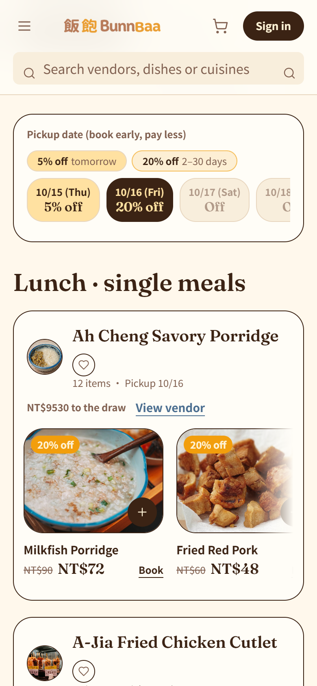
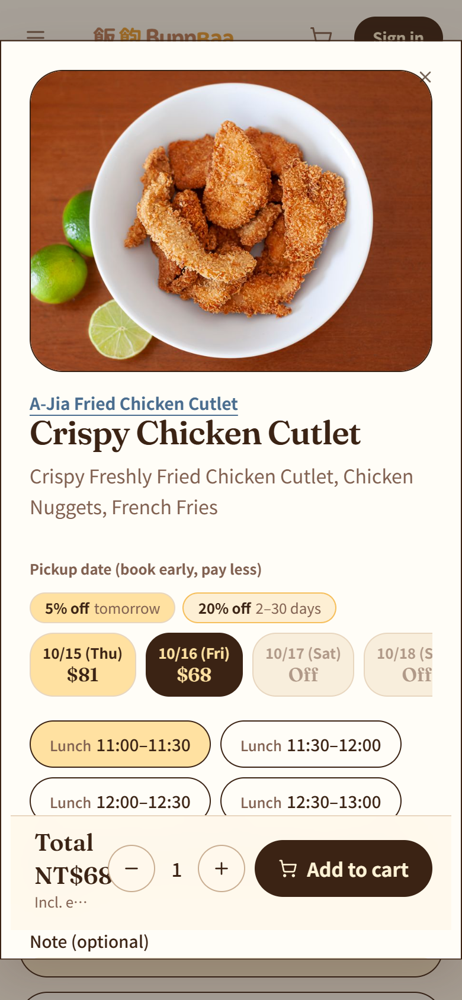
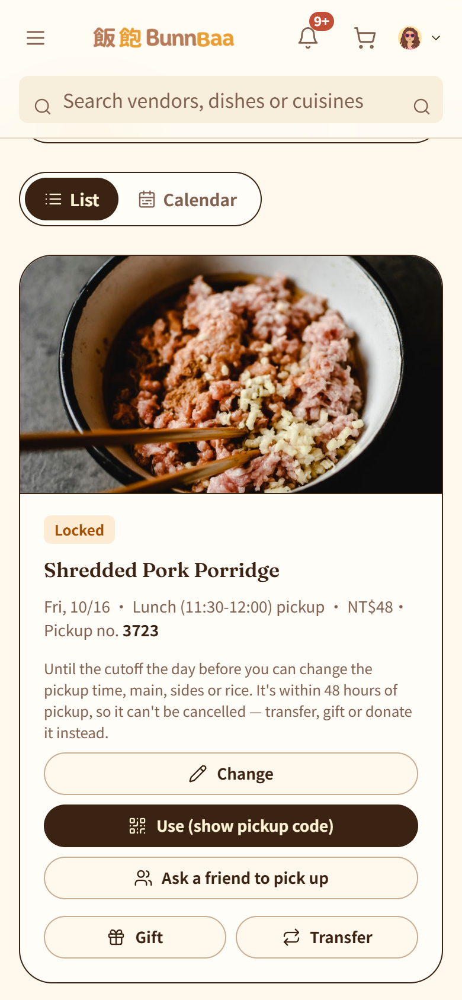

# Every Meal Cooked Gets Eaten: Why We Built BunnBaa

> Cook what's ordered. Eat what's cooked.

It's 12:05 p.m., and the line outside the lunchbox shop by the campus back gate is already long. You check your watch. Class starts at one, and by the time you reach the counter, the signature chicken leg rice will probably be gone.

At the same moment, the owner is chopping vegetables in the back and worrying about something else: they ordered eighty chicken legs today. Will twenty be left over again?

When the shop closes at 8 p.m., whatever didn't sell goes in the bin. The next morning, before a single customer has walked in, the owner has to call the supplier and order ingredients all over again.

**BunnBaa (飯飽)** is built for both of these people: you, waiting in line with no guarantee of a meal, and the owner who has to guess every day how many customers will come tomorrow.

---

## The problem isn't cooking too much. It's not knowing how much to cook.

Small eateries near campuses and offices face a hard structural problem: **they have to decide how much to prepare before anyone orders.**

- Guess high, and the ingredients get thrown away.
- Guess low, and customers get turned away and go somewhere else.
- Even a meal that's already paid for goes to waste when its owner's plans change, because nobody else knows it's available.

It isn't easy on the diner's side either. You queue every day with no guaranteed meal, and deciding early gets you nothing.

All these small losses add up. According to the UN Environment Programme's *Food Waste Index Report 2024*, the world wasted **1.05 billion tonnes** of food in 2022, 19% of all food available to consumers, and **290 million tonnes** of it was wasted in food service.

We can't fix the world's food waste in one go. But we can start with one small eatery at a time.

---

## How BunnBaa works, in four steps

### 1. Lock: the earlier you book, the cheaper it is

Diners can book breakfast, lunch or dinner up to 30 days ahead and pay with LINE Pay.

- **Book two or more days early: 20% off**
- **Book for tomorrow: 5% off**

This is the heart of the design: deciding early should pay off. You save money and the owner gets a confirmed order. Everybody wins.

  
  

### 2. Cut-off: the owner finally knows how much to cook tomorrow

Orders close at 20:00 the night before. The owner gets an **exact count**, along with an automatically generated **purchase list** and **prep list**.

To plan the days after that, the owner can check a **7-day demand forecast** from BigQuery.

### 3. Pass it on: plans change, but the meal doesn't go to waste

Can't make it? No problem. You can:

- **Resell** it to someone who wants it
- **Gift** it to a friend
- **Donate** it as a free charity meal

And any meal nobody claims **automatically becomes a charity meal** for someone who needs it.

### 4. Pick up: just a quick scan

At the counter, the owner scans the QR code on your phone and you're done. The code is signed and expires, and a screenshot can't be reused, so nobody else can claim your meal.

---

## Where AI helps

We use **Gemini on Vertex AI** and **BigQuery AI** on Google Cloud to add four AI helpers along the life of a meal.

### 📸 List: just take a photo of the menu

Many small eatery owners don't have the time, or the know-how, to build an online menu. With BunnBaa, **the owner just takes a photo of the paper menu on the wall**. Gemini reads the items, prices, categories, dietary tags and allergens, and turns them into bilingual (Chinese and English) drafts.

Most importantly, **nothing goes live until the owner confirms it.** AI writes the draft; the owner always makes the call.

### 💬 Find: plan a week of lunches like you're texting a friend

Don't want to browse menus one by one? Just tell the pre-order assistant:

> "Lunch next Mon–Fri, Da'an district, under NT$120, no beef."

The assistant replies with **meal cards you can book right away**. It also reads BigQuery's demand forecast to put quieter shops first, and suggests add-ons that go well with your order.

We built in several layers of protection:

- Allergens are **checked twice on the server**: once during the search and again on the final cards.
- The assistant **can only show items its own search just returned**, so it can't make up a dish.
- Prices are **recalculated on the server** at checkout.
- The assistant only suggests. It **never places an order for you**.

We tested the assistant with 24 questions covering budgets, allergies, vegetarian diets, meal times, multi-day plans and questions in English. All 24 passed the rule checks with **zero allergen violations**. The Vertex AI Gen AI Evaluation Service scored it 4.79/5 for fulfillment and 4.96/5 for groundedness.

### 🔁 Rescue: find a new home for every resold meal

When someone lists a meal for resale, BunnBaa uses `gemini-embedding-001` to turn the dish into a vector. Firestore Vector Search then finds **nearby diners who have eaten similar dishes**, and BunnBaa sends them a push notification.

We kept these notifications deliberately calm:

- Only diners **within 10 km** are notified
- At most **2 resale alerts per person per day**
- **One tap** turns them off
- No "Only 3 left!" or "10 minutes to go!" urgency tricks

We want BunnBaa to be a place where you can eat with peace of mind, not another app that keeps nagging you.

### 📊 Calibrate: forecasts an owner can actually read

After cut-off, the owner sees something like this:

> "42 locked → 38–41 expected."

Every evening there's also a plain-language report, and the owner can ask what-if questions directly.

The longer-range demand forecast behind it runs on BigQuery's `AI.FORECAST`, which uses the TimesFM time-series model. It **doesn't need to be trained for each shop**, so even a brand-new shop with little history gets a usable forecast from day one.

---

## Two principles we stick to

### Code does the math; AI only explains it

Portions, prices, discounts, payouts, prize draws: every number that touches money is calculated by tested code. Gemini's job is to **explain those numbers in plain language**. So even if the AI gets something wrong, it can't change an amount of money.

### AI drafts, people decide

Every AI output comes with a reminder. Owners confirm menus. AI-drafted recipes stay marked as drafts until the owner saves them. The demand forecast is labelled "for reference", not as an instruction. The pre-order assistant suggests but never orders.

AI makes a great helper, but it shouldn't make decisions for people.

---

## For vendors: no monthly fee, we only earn when a meal sells

Small eateries already run on thin margins, so we **don't charge a monthly fee**. The platform keeps 5% of each meal **actually sold**, deducted at payout. If nothing sells, nothing is charged.

---

## How do we know we're really reducing waste?

"Reducing food waste" can easily become just a slogan, so we decided to **count from records, not estimates**. Each outcome is written to Firestore the moment it happens, streamed to BigQuery, and shown on a Looker Studio dashboard:

- Meals rescued through AI matching
- Meals resold and picked up
- Charity meals claimed
- Forecast vs. actual demand for each vendor, and how accurate each vendor's forecasts are

---

## Come try it

BunnBaa is our entry for the **Google Cloud AI Builder Cup 2026**, under the theme *Retail & Commerce: Intelligent Customer and Business Experiences*, with a focus on **sustainability: reducing food waste**.

- 🌐 **Live prototype**: https://bunnbaa-mvp-5474.web.app/?lang=en
- 🎬 **3-minute demo video**: https://youtu.be/ZhRAGfqUVDs

You don't need an account to browse menus. To try booking, reselling or prize draws, open **Sign in** and click **Demo accounts** to log in with one tap. Payments run in the LINE Pay sandbox, so **no real money moves**. Play around as much as you like.

If you're a developer curious about how it's built, the full architecture and source code are on GitHub: https://github.com/Donna12301230/bunnbaa-mvp

---

Next time you're stuck in a lunch line, worried the chicken leg rice will sell out, we hope you'll remember: you could have booked it two days ago for 20% off and just scanned and walked out with it.

And the owner could finally cook just the right amount.

**Cook what's ordered. Eat what's cooked.** That's what BunnBaa is here to do.

*— The BunnBaa team: 鍾雅婷, 蘇雅雯 and 陳信喜*
